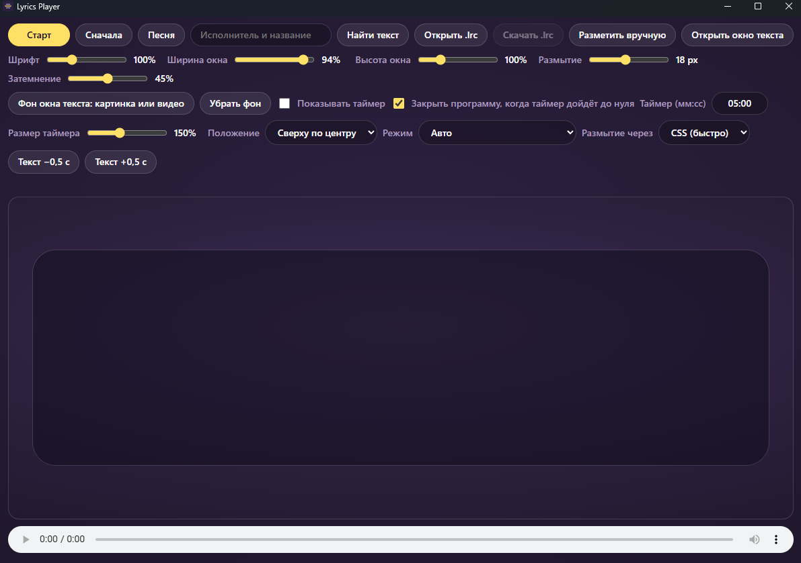
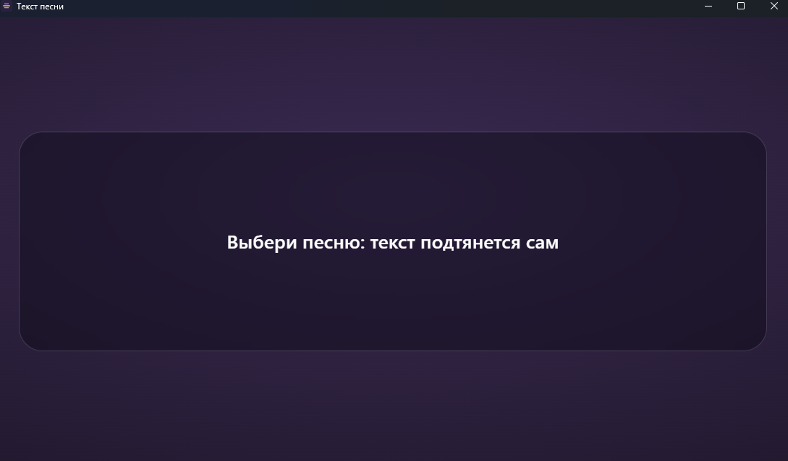

<div align="center">

# 🎤 Lyrics Player

**Синхронный текст песни на большом экране: в стиле Яндекс Музыки, с видеофоном и таймером.**
Своё окно управления, отдельное окно вывода для проектора, поиск текстов в LRCLIB.

[](https://github.com/Archmage90105/lyrics/releases/latest)
[](https://github.com/Archmage90105/lyrics/releases)


  

</div>

## ✨ Возможности

- **Текст в стиле Яндекс Музыки:** текущая строка крупная и яркая, соседние приглушены, прокрутка плавная.
- **Свой плеер:** выберите песню с компьютера (mp3, flac, wav, ogg, opus, m4a, aac, wma).
- **Автопоиск текста** с таймкодами в [LRCLIB](https://lrclib.net) по названию файла. Найденное запоминается и потом работает без интернета.
- **Свои тексты:** открыть `.lrc`, разметить песню вручную по нажатию (пробел) и сохранить `.lrc`.
- **Отдельное окно вывода** для проектора или второго монитора. F11 включает полный экран, клик по строке перематывает песню.
- **Фон окна текста:** картинка или видео, размытие и затемнение под текстом.
- **Таймер обратного отсчёта:** размер, положение, плавная смена цифр; по желанию программа закрывается, когда время вышло.
- **Подстройка сдвига текста** кнопками −0,5 с / +0,5 с.
- **Режимы производительности** (авто / максимум / лёгкий / только видео): на слабых ноутбуках приложение само упрощает оформление, если видео начинает пропускать кадры.
- Все настройки запоминаются.

## 📥 Установка

1. Откройте [**Releases**](https://github.com/Archmage90105/lyrics/releases/latest) и скачайте файл `*_x64-setup.exe`.
2. Запустите установщик.

> **Windows может показать «Система Windows защитила ваш компьютер».** Установщик не подписан цифровой подписью. Нажмите **«Подробнее» → «Выполнить в любом случае»**.
>
> Нужен WebView2: в Windows 11 и обновлённой Windows 10 он уже есть, иначе установщик скачает его сам (потребуется интернет).

## 🚀 Как пользоваться

1. Нажмите **«Песня»** и выберите аудиофайл. Название файла подставится в поиск, текст найдётся автоматически. Если нет, нажмите **«Найти текст»** или **«Открыть .lrc»**.
2. Нажмите **«Открыть окно текста»** и перетащите окно на проектор или второй монитор. **F11**: полный экран, **Esc**: выйти из него.
3. Нажмите **«Старт»**. Музыка, видеофон и таймер запускаются вместе.
4. Настройте вид ползунками: шрифт, ширина и высота окна, размытие, затемнение, размер и положение таймера.

**Фон.** Кнопка **«Фон окна текста: картинка или видео»**. Фон показывается только в окне вывода, в превью его нет.

**Таймер.** Включите «Показывать таймер», задайте время в формате `мм:сс`. Галочка «Закрыть программу, когда таймер дойдёт до нуля» закроет приложение через 3 секунды после нуля (отмена: кнопка «Сначала»).

**Если текста нет в базе.** Нажмите **«Разметить вручную»**, вставьте текст (одна строка на строку), нажмите «Начать с начала песни» и отмечайте каждую строку пробелом в момент, когда её поют. Затем **«Скачать .lrc»**, чтобы не размечать заново.

| Клавиша | Действие |
|---|---|
| `Пробел` | отметить следующую строку (при ручной разметке) |
| `F11` | полный экран в окне текста |
| `Esc` | выйти из полного экрана |

## 🎞️ Советы по видеофону

Самый надёжный формат: **MP4, H.264, 8 бит, 1080p, 30 fps, без звука**. Пересохранить можно так:

```bash
ffmpeg -i in.mp4 -vf "scale=-2:1080,fps=30,format=yuv420p" -c:v libx264 -profile:v high -preset slow -crf 20 -an -movflags +faststart out.mp4
```

Если видео пропускает кадры, переключите **«Режим»** на «Лёгкий» или оставьте «Авто»: приложение само отключит размытие и тень текста. Видео меньше 500 МБ читается в память целиком, поэтому не зависит от скорости диска.

## 🛠️ Сборка из исходников

Нужны [Node.js 20+](https://nodejs.org), [Rust](https://rustup.rs) и на Windows C++ Build Tools.

```bash
npm install
npm run tauri dev      # разработка
npm run tauri build    # установщик: src-tauri/target/release/bundle/
```

**Автосборка релиза:** вкладка **Actions → Release → Run workflow**. Версия берётся из `src-tauri/tauri.conf.json`, перед релизом меняйте её также в `package.json` и `src-tauri/Cargo.toml`. Готовый установщик появится в Releases как черновик.

### Структура

```
index.html, src/main.js     главное окно: плеер, поиск, настройки, превью
lyrics-view.html, src/view.js   окно вывода текста
src/display.js              общий код отрисовки
src/bus.js                  события между окнами
src-tauri/                  Rust-часть и конфиг Tauri 2
web/lyrics.html             браузерная версия в одном файле
```

Окна обмениваются данными событиями Tauri, а аудио и фон открываются по пути к файлу через asset-протокол, поэтому оба окна видят один и тот же файл.

## 🌐 Браузерная версия

В `web/lyrics.html` лежит версия в одном файле: откройте её в Chrome или Edge. Возможности те же, но без установки и без автозакрытия.

## 🙏 Благодарности и тексты песен

- Тексты с таймкодами берутся из открытой базы [LRCLIB](https://lrclib.net). В репозитории и в приложении тексты песен не хранятся.
- Построено на [Tauri](https://tauri.app) и [Vite](https://vitejs.dev).
- Ответственность за использование текстов и музыки лежит на пользователе: убедитесь, что у вас есть право их воспроизводить.

## 📄 Лицензия

<!-- Укажите лицензию, например MIT, и добавьте файл LICENSE -->
